# Rootline architecture diagrams

A visual map of Rootline for developers. Read it alongside [ARCHITECTURE.md](ARCHITECTURE.md) (the written guide) and [DECISIONS.md](DECISIONS.md) (why things are the way they are). GitHub draws every diagram below. Under each one, a table links each box to the code behind it.

**Contents**
1. [System context](#1-system-context): Rootline and the services around it
2. [Code layers](#2-code-layers): how a request travels through the folders
3. [Feature dependencies](#3-feature-dependencies): which feature uses which
4. [Data model](#4-data-model): tables and their relationships
5. [Security layers](#5-security-layers): who can see what, enforced where
6. [Flow: a shopper scans a QR code](#6-flow-a-shopper-scans-a-qr-code)
7. [Flow: a producer saves a form](#7-flow-a-producer-saves-a-form-server-action)
8. [Flow: creating and publishing a batch](#8-flow-creating-and-publishing-a-batch)
9. [Flow: subscribing to a plan (Stripe)](#9-flow-subscribing-to-a-plan-stripe)
10. [Flow: recalls](#10-flow-recalls) and [shopper photos](#11-flow-shopper-photos)
12. [Deployment and environments](#12-deployment-and-environments)
13. [Where to start reading](#13-where-to-start-reading)

---

## 1. System context

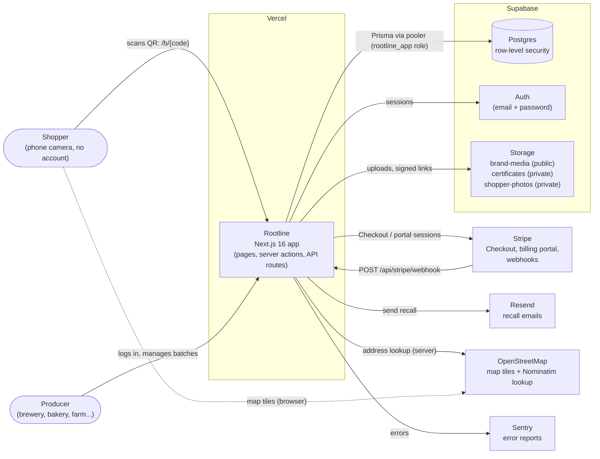

| Box | Code |
|---|---|
| Rootline app | [`src/app`](../src/app), [`next.config.ts`](../next.config.ts) |
| Postgres + RLS | [`prisma/schema.prisma`](../prisma/schema.prisma), [`prisma/migrations`](../prisma/migrations), [`src/lib/db.ts`](../src/lib/db.ts) |
| Auth | [`src/lib/auth.ts`](../src/lib/auth.ts), [`src/lib/supabase.ts`](../src/lib/supabase.ts), [`src/lib/supabase-proxy.ts`](../src/lib/supabase-proxy.ts), [`src/features/auth`](../src/features/auth) |
| Storage | [`src/lib/storage.ts`](../src/lib/storage.ts), [`src/lib/storage-rules.ts`](../src/lib/storage-rules.ts), [`scripts/setup-storage.ts`](../scripts/setup-storage.ts) |
| Stripe | [`src/features/billing/server`](../src/features/billing/server), [`src/app/api/stripe/webhook/route.ts`](../src/app/api/stripe/webhook/route.ts), [`scripts/stripe-setup.ts`](../scripts/stripe-setup.ts) |
| Resend | [`src/lib/email.ts`](../src/lib/email.ts) |
| OpenStreetMap | [`src/lib/geocode.ts`](../src/lib/geocode.ts), [`src/app/api/geocode/route.ts`](../src/app/api/geocode/route.ts), [`src/features/story-page/components/RouteMap.tsx`](../src/features/story-page/components/RouteMap.tsx) |
| Sentry | [`src/lib/sentry.ts`](../src/lib/sentry.ts), [`src/instrumentation.ts`](../src/instrumentation.ts) |

---

## 2. Code layers

Routes stay thin. They call **features**, which own their rules and database access. Features use shared **lib** plumbing and **ui** components. Only feature `server/` folders (and `src/lib`) may touch the database; ESLint enforces this.

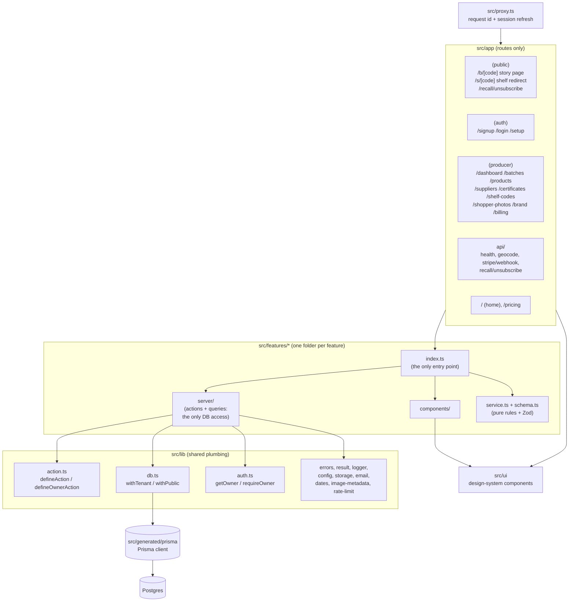

| Box | Code |
|---|---|
| Proxy (middleware) | [`src/proxy.ts`](../src/proxy.ts), [`src/lib/request-id.ts`](../src/lib/request-id.ts) |
| Route groups | [`(public)`](../src/app/%28public%29), [`(auth)`](../src/app/%28auth%29), [`(producer)`](../src/app/%28producer%29), [`api`](../src/app/api) |
| Server action wrapper | [`src/lib/action.ts`](../src/lib/action.ts) |
| Tenant / public database access | [`src/lib/db.ts`](../src/lib/db.ts) |
| Typed results and errors | [`src/lib/result.ts`](../src/lib/result.ts), [`src/lib/errors.ts`](../src/lib/errors.ts) |
| Import rules | [`eslint.config.mjs`](../eslint.config.mjs) |
| UI components | [`src/ui/index.ts`](../src/ui/index.ts) |

---

## 3. Feature dependencies

An arrow means "imports from that feature's `index.ts`". Arrows only point downwards: `industries` and `billing` sit at the bottom and depend on no other feature.

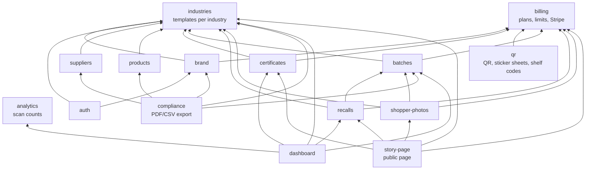

| Feature | Folder | What it owns |
|---|---|---|
| industries | [`src/features/industries`](../src/features/industries) | Templates: words, fields, dates, badges, stops; the "What do you make?" cards |
| billing | [`src/features/billing`](../src/features/billing) | Plans, limits, pricing page, Plan & billing, Stripe |
| brand | [`src/features/brand`](../src/features/brand) | Brand profile, people, photos |
| auth | [`src/features/auth`](../src/features/auth) | Sign-up, login, finish setting up, producer navigation |
| suppliers | [`src/features/suppliers`](../src/features/suppliers) | Farms and suppliers with map positions |
| products | [`src/features/products`](../src/features/products) | Products, ingredients, allergens |
| certificates | [`src/features/certificates`](../src/features/certificates) | Certificate files and "is this badge valid?" |
| batches | [`src/features/batches`](../src/features/batches) | Batches, lots, journey stops, statuses |
| qr | [`src/features/qr`](../src/features/qr) | QR images, sticker sheets, shelf codes |
| story-page | [`src/features/story-page`](../src/features/story-page) | The public page shoppers see |
| recalls | [`src/features/recalls`](../src/features/recalls) | Recall sign-ups, sending, unsubscribe |
| shopper-photos | [`src/features/shopper-photos`](../src/features/shopper-photos) | Shared photos and approval |
| analytics | [`src/features/analytics`](../src/features/analytics) | Scan recording and counts |
| dashboard | [`src/features/dashboard`](../src/features/dashboard) | Producer home |
| compliance | [`src/features/compliance`](../src/features/compliance) | Batch record as PDF and CSV |

Every feature folder has the same shape: `README.md`, `index.ts`, `schema.ts`, `service.ts`, `components/`, `server/`, `tests/`.

---

## 4. Data model

Every table belongs to a **brand**, directly or through a batch. Dates are stored as UTC in "timestamp without time zone" columns.

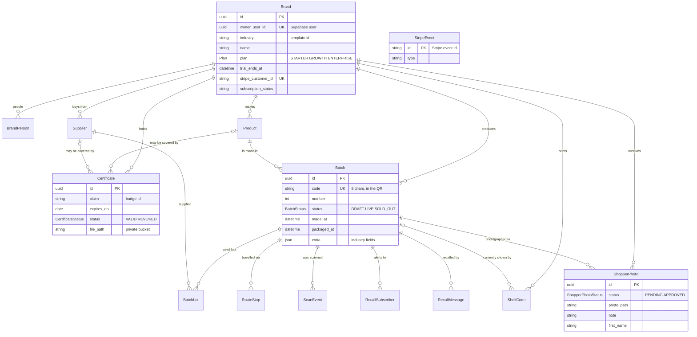

| Item | Code |
|---|---|
| Schema | [`prisma/schema.prisma`](../prisma/schema.prisma) |
| Migrations (incl. hand-written RLS SQL) | [`prisma/migrations`](../prisma/migrations) |
| Demo data | [`prisma/seed.mts`](../prisma/seed.mts), [`prisma/seed`](../prisma/seed) |

---

## 5. Security layers

Two independent walls: the app scopes every query by brand, and **Postgres row-level security** blocks any row that doesn't belong to the caller, even if the app has a bug.

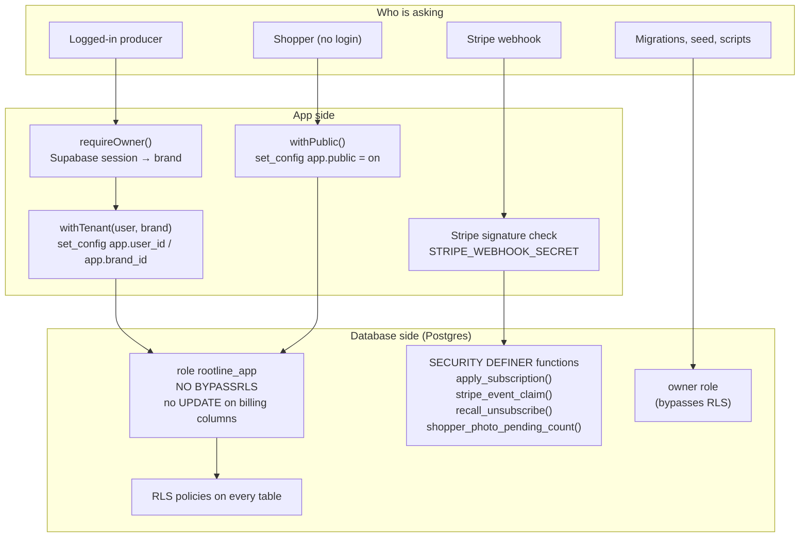

| What the public (story pages) can do | Policy |
|---|---|
| Read LIVE / SOLD_OUT batches and what their story shows | `story_page_public_access` migration |
| Add a scan, a recall sign-up, or a PENDING shopper photo | Insert-only policies; the app inserts with `createMany` (no read-back) |
| Never: read drafts, emails, waiting photos, scans, billing | No policy allows it |

| Item | Code |
|---|---|
| Owner lookup and redirects | [`src/lib/auth.ts`](../src/lib/auth.ts) |
| `withTenant`, `withPublic` | [`src/lib/db.ts`](../src/lib/db.ts) |
| Role and policies | [`20261024225451_brand_and_people`](../prisma/migrations/20261024225451_brand_and_people/migration.sql), [`20261025010901_story_page_public_access`](../prisma/migrations/20261025010901_story_page_public_access/migration.sql), [`20261027011112_billing_plans`](../prisma/migrations/20261027011112_billing_plans/migration.sql) |
| Tests that prove it | [`src/lib/tests/rls.db.test.ts`](../src/lib/tests/rls.db.test.ts), [`src/lib/tests/public-read.db.test.ts`](../src/lib/tests/public-read.db.test.ts), [`src/features/billing/tests/billing.db.test.ts`](../src/features/billing/tests/billing.db.test.ts), [`src/features/shopper-photos/tests/shopper-photos.db.test.ts`](../src/features/shopper-photos/tests/shopper-photos.db.test.ts) |

---

## 6. Flow: a shopper scans a QR code

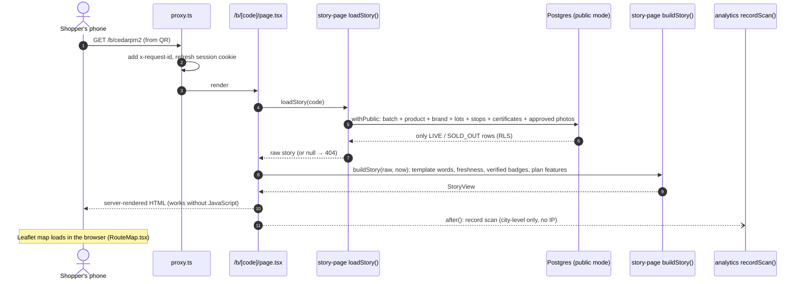

Code: [`src/app/(public)/b/[code]/page.tsx`](../src/app/%28public%29/b/%5Bcode%5D/page.tsx) · [`story-page/server/queries.ts`](../src/features/story-page/server/queries.ts) · [`story-page/service.ts`](../src/features/story-page/service.ts) · [`story-page/components`](../src/features/story-page/components) · [`analytics/server`](../src/features/analytics/server) · shelf codes: [`src/app/(public)/s/[code]/route.ts`](../src/app/%28public%29/s/%5Bcode%5D/route.ts)

---

## 7. Flow: a producer saves a form (server action)

Every producer form follows this path. Swap in any action, e.g. `createSupplier`, `uploadCertificate`, `sendRecall`.

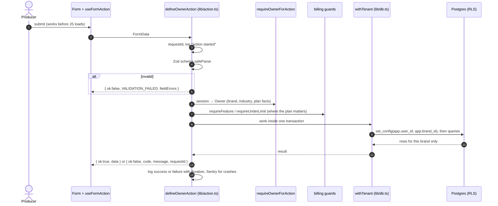

Code: [`src/ui/useFormAction.ts`](../src/ui/useFormAction.ts) · [`src/lib/action.ts`](../src/lib/action.ts) · [`src/lib/auth.ts`](../src/lib/auth.ts) · [`src/features/billing/guards.ts`](../src/features/billing/guards.ts) · [`src/lib/db.ts`](../src/lib/db.ts) · [`src/lib/logger.ts`](../src/lib/logger.ts)

---

## 8. Flow: creating and publishing a batch

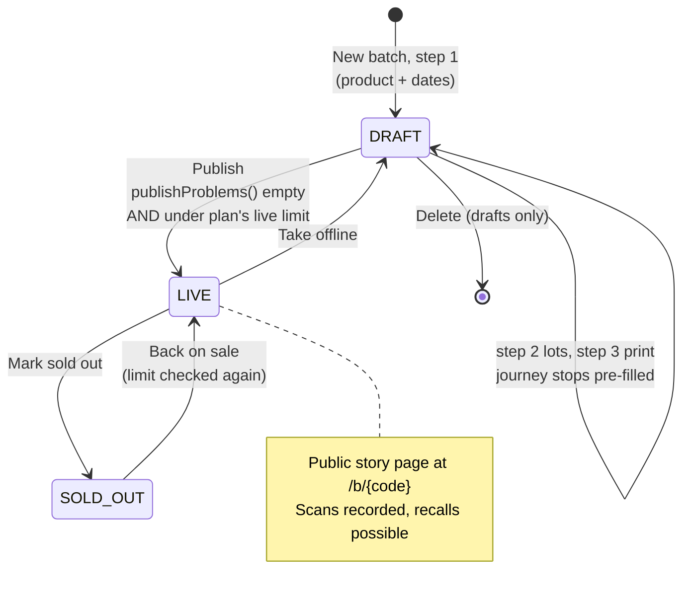

Code: [`batches/service.ts`](../src/features/batches/service.ts) (`publishProblems`, `canChangeStatus`) · [`batches/server/status-actions.ts`](../src/features/batches/server/status-actions.ts) · [`batches/server`](../src/features/batches/server) · [`src/app/(producer)/batches`](../src/app/%28producer%29/batches) · QR and sticker sheet: [`qr/server`](../src/features/qr/server)

---

## 9. Flow: subscribing to a plan (Stripe)

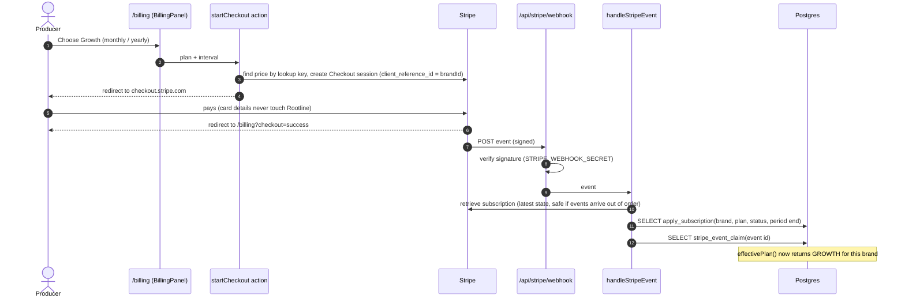

Code: [`billing/plans.ts`](../src/features/billing/plans.ts) · [`billing/service.ts`](../src/features/billing/service.ts) (`effectivePlan`) · [`billing/server/actions.ts`](../src/features/billing/server/actions.ts) · [`billing/server/webhook.ts`](../src/features/billing/server/webhook.ts) · [`api/stripe/webhook/route.ts`](../src/app/api/stripe/webhook/route.ts) · [`billing_plans` migration](../prisma/migrations/20261027011112_billing_plans/migration.sql)

---

## 10. Flow: recalls

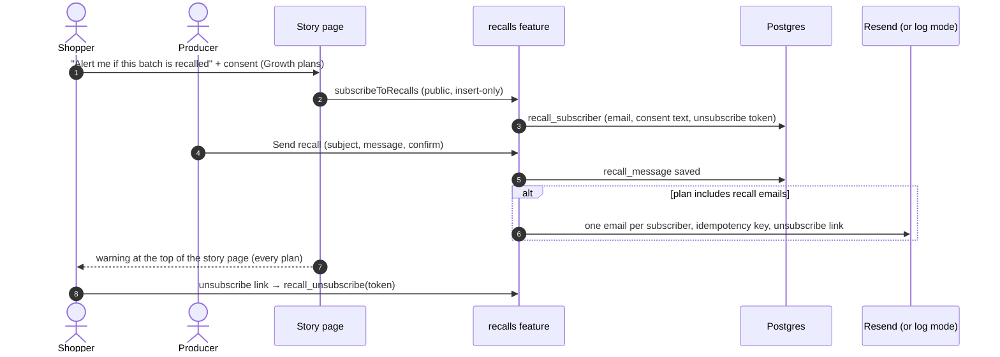

Code: [`src/features/recalls`](../src/features/recalls) · [`src/lib/email.ts`](../src/lib/email.ts) · [`src/app/(public)/recall/unsubscribe`](../src/app/%28public%29/recall/unsubscribe) · [`src/app/api/recall/unsubscribe`](../src/app/api/recall/unsubscribe)

## 11. Flow: shopper photos

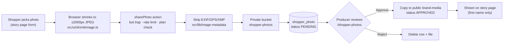

Code: [`src/features/shopper-photos`](../src/features/shopper-photos) · [`src/lib/image-metadata`](../src/lib/image-metadata) · [`src/lib/rate-limit.ts`](../src/lib/rate-limit.ts) · [`src/ui/shrinkImage.ts`](../src/ui/shrinkImage.ts)

---

## 12. Deployment and environments

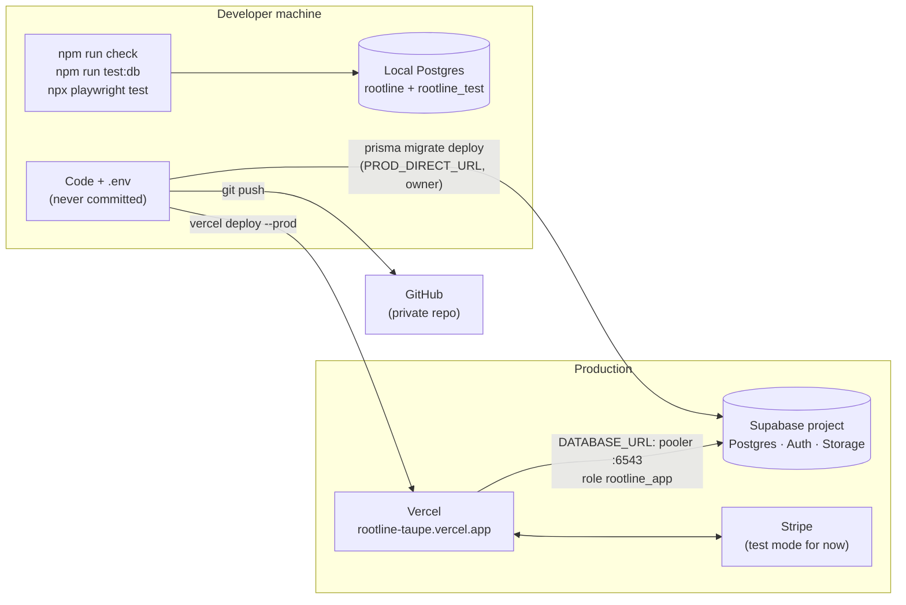

**Releasing a change:** run the checks, apply any new migration to production, then `vercel deploy --prod`. Details are in the [README](../README.md#deploying). Environment variables are listed in [`.env.example`](../.env.example).

---

## 13. Where to start reading

| If you want to… | Start here |
|---|---|
| Understand one request end to end | [`src/app/(public)/b/[code]/page.tsx`](../src/app/%28public%29/b/%5Bcode%5D/page.tsx), then [`story-page`](../src/features/story-page) |
| Add a form or action | Copy the pattern in [`suppliers/server`](../src/features/suppliers/server) and [`src/lib/action.ts`](../src/lib/action.ts) |
| Add an industry | [`industries/README.md`](../src/features/industries/README.md) |
| Change a plan or price | [`billing/plans.ts`](../src/features/billing/plans.ts), then `npm run stripe:setup` |
| Change who can see what | The RLS SQL in [`prisma/migrations`](../prisma/migrations) and its `*.db.test.ts` tests |
| Find why something was built a certain way | [`DECISIONS.md`](DECISIONS.md) |
| Fix a problem | [`TROUBLESHOOTING.md`](TROUBLESHOOTING.md) |
